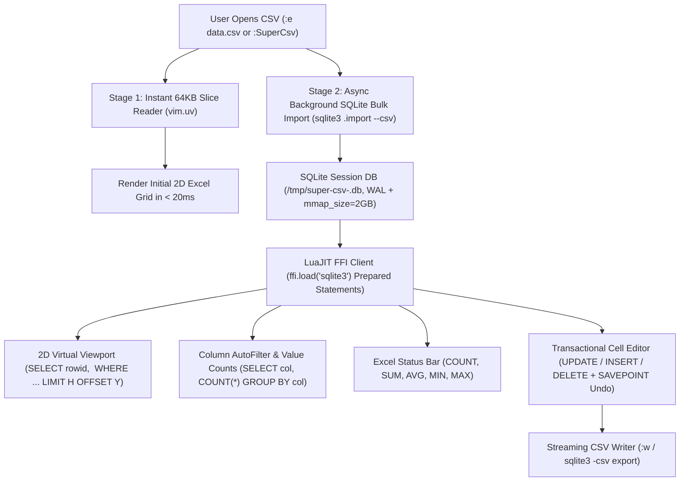
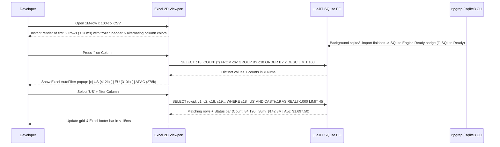

# Technical Specification: `super-csv.nvim`

> **Document Status**: DRAFT

> [!IMPORTANT]
> **Mission**: Build the ultimate Excel-inspired, developer-first CSV/TSV/DSV viewer, spreadsheet filter, grep tool, and editor for Neovim (`>= 0.10`). Engineered to handle **1,000,000+ rows and 100+ columns** effortlessly by combining an **Instant 64KB Previewer** with a **SQLite (`libsqlite3` FFI + `sqlite3` CLI) + `ripgrep` Hybrid Engine** and an **Excel-Grade 2D Virtual Viewport**.

---

## 1. Why Developers Open a CSV in Neovim (Core User Journeys)

When a developer opens a CSV file in Neovim (whether it is a 200-row fixture, a 50,000-row production export, or a 1,000,000-row × 100-column telemetry dump), they want **immediate spreadsheet superpowers** without leaving Neovim or writing one-off Python/awk scripts:

1. **Excel-Like Visual Readability at a Glance**:
   - **Prominent Frozen Header Row**: High-contrast, bold header bar pinned at the top with column letters (`A`, `B`, `C`... `CV`), column numbers (`#1..#100`), data-type icons (`123`, `ABC`, `📅`, `✓`), sort arrows (`▲`/`▼`), and filter funnel badges (`󰈲`).
   - **Alternating Column & Row Shading (Zebra Striping)**: Distinct background tints for **even vs. odd columns** (`SuperCsvColEven` / `SuperCsvColOdd`) and subtle row striping so your eyes never lose track of columns or rows across wide tables.
   - **Excel Freeze Panes (`gp`)**: Lock primary key columns (e.g., `id`, `user_email`, `timestamp`) on the left behind a double vertical separator `║` while scrolling horizontally across columns `#3..#100`.
   - **Crosshair Cursor Highlighting**: Highlight the active cell (`D14`) with a bold cell border/background while subtly highlighting both column header `D` and row `14`.

2. **Instant Column Filtering (Like Excel AutoFilter)**:
   - Press `f` on any column to open an **Excel-Style AutoFilter Menu**:
     - Shows the **Top Unique Values with Exact Row Counts** (e.g., `[x] COMPLETED (612,400)`, `[x] PENDING (84,120)`, `[ ] FAILED (3,480)` — toggle values with `<Space>` or `<CR>`!).
     - Supports quick condition filters: `=`, `!=`, `> 1000`, `< 50`, `between`, `contains`, `starts with`, `regex`, `is empty / NULL`, `not NULL`.
   - Stack multiple column filters simultaneously and see the live filtered count in the header bar: `Showing 3,480 / 1,000,000 rows (0.35%)`.

3. **Quick Counts, Value Frequencies & Spreadsheet Aggregations (`SUM`, `AVG`, `MIN`, `MAX`, `COUNT`)**:
   - **Live Excel Status Bar (Footer Summary)**: Automatically displays `RowCount`, `NotNull`, `Distinct`, `SUM`, `AVG`, `MIN`, `MAX` for the current column (or visually selected rows) at the bottom of the window.
   - **One-Key Value Frequency / Group-By Breakdown (`gv` / `:SuperCsv freq`)**: Press `gv` on any column (e.g., `status`, `country`, `http_code`) to pop up a frequency breakdown table (`Value | Count | % | Bar | Sum`) and press `<CR>` on any bucket to filter the grid to that value.

4. **Blazing-Fast Grep Across Rows & Columns (`g/` / `:SuperCsv grep`)**:
   - Run `:SuperCsv grep <pattern>` (or press `g/`) to filter the entire 1,000,000-row table down to rows matching a regex or substring (powered by `rg` + SQLite), keeping the full 2D column layout intact and highlighting the matched cells.

5. **SQLite-Powered Speed & Ad-Hoc SQL (`gq` / `:SuperCsv sql`)**:
   - Instead of re-parsing 100MB–1GB of CSV text in Lua on every filter/sort/aggregation, `super-csv.nvim` backs the session with **SQLite (`sqlite3` + LuaJIT `ffi.load("sqlite3")`)**.
   - Developers can press `gq` (or `:SuperCsv sql SELECT region, count(*), sum(amount) FROM csv GROUP BY 1 ORDER BY 3 DESC`) to run arbitrary SQL on their CSV and inspect the result as a new interactive grid.

---

## 2. System Architecture: Hybrid Instant-Preview + SQLite Backend

### 2.1 Why SQLite (`libsqlite3` FFI + `sqlite3` CLI) Beats Pure CSV Parsing at 1M × 100 Scale

| Operation on 1,000,000 Rows × 100 Cols | Naive Lua CSV Re-Parse | `super-csv.nvim` SQLite + FFI Engine |
| :--- | :--- | :--- |
| **Time to First Render (Open File)** | 8,000 – 45,000 ms (Freeze) | **< 20 ms** (Stage 1 reads first 64KB directly) |
| **Scroll to Row 850,000 (`LIMIT 45 OFFSET 850000`)** | 1,500+ ms | **< 0.4 ms** (`WHERE rowid >= 850000 LIMIT 45` via B-Tree PK) |
| **Column Aggregations (`SUM`, `AVG`, `MIN`, `MAX`, `COUNT`)** | 3,500+ ms | **~45 ms** (C-level vectorized scan in SQLite) |
| **Unique Value Counts (`GROUP BY col ORDER BY count DESC`)** | 4,000+ ms + OOM risk | **~60 ms** (SQLite native hash/B-tree group-by) |
| **Multi-Column Filter + Sort** | 6,000+ ms | **< 80 ms** (SQLite query planner + optional on-demand column index) |
| **Cell Edit + Undo/Redo (`SAVEPOINT`)** | Full file rewrite | **< 0.2 ms** (`UPDATE csv SET c19 = ? WHERE rowid = ?` + SQLite `SAVEPOINT`) |

### 2.2 Two-Stage Lifecycle Diagram



### 2.3 Interactive Developer Workflow Sequence



---

## 3. Excel-Grade Visual Design & Layout Specification

### 3.1 Color & Highlight Hierarchy (`lua/super-csv/highlights.lua`)

To deliver Microsoft Excel-level visual clarity inside Neovim, `super-csv.nvim` defines dedicated highlight groups that adapt automatically to `dark` and `light` colorschemes:

| Highlight Group | Visual Role | Default Styling (Dark Theme Example) |
| :--- | :--- | :--- |
| `SuperCsvHeaderBanner` | Top status & filter breadcrumb bar | `bg=#1e293b, fg=#f8fafc, bold=true` |
| `SuperCsvHeaderPinned` | Frozen column header cells (`#1 id 🔒`) | `bg=#0f3460, fg=#e2e8f0, bold=true` (Prominent Excel Header Accent) |
| `SuperCsvHeaderNormal` | Scrollable column header cells | `bg=#1e3a5f, fg=#ffffff, bold=true` |
| `SuperCsvHeaderActive` | Header of the currently focused column | `bg=#2563eb, fg=#ffffff, bold=true, underline=true` |
| `SuperCsvHeaderFiltered` | Header of a column with an active filter (`󰈲`) | `bg=#065f46, fg=#6ee7b7, bold=true` |
| `SuperCsvColEven` | **Even Column Background Tint** (Cols 2, 4, 6...) | `bg=#111827` (Base surface) |
| `SuperCsvColOdd` | **Odd Column Background Tint** (Cols 1, 3, 5...) | `bg=#182234` (Subtle alternating column contrast) |
| `SuperCsvColPinned` | Frozen left key columns (`freeze_cols`) | `bg=#17253b` (Distinct pinned pane background) |
| `SuperCsvCursorRow` | Active row crosshair highlight | `bg=#1e293b` across non-active cells of current row |
| `SuperCsvCursorCell` | **Active Selected Cell (`(row, col)`)** | `bg=#f59e0b, fg=#0f172a, bold=true` (High-visibility Excel cell cursor) |
| `SuperCsvCellModified` | Unsaved edited cell (`●`) | `bg=#3b1d2e, fg=#fda4af, bold=true` |
| `SuperCsvCellMatch` | Grep / Search match highlight | `bg=#713f12, fg=#fde047, bold=true` |
| `SuperCsvFooterSummary` | Bottom Excel aggregation bar (`SUM`, `AVG`, `COUNT`) | `bg=#0f172a, fg=#38bdf8, bold=true` |
| `SuperCsvTypeNumber` | Right-aligned numbers & currency cells | `fg=#fbbf24` |
| `SuperCsvTypeBool` | Boolean `true` / `false` badges | `fg=#34d399` (`true`) / `fg=#f87171` (`false`) |
| `SuperCsvTypeNull` | Empty / `NULL` / `NaN` cells | `fg=#64748b, italic=true` |

### 3.2 Viewport Mockup (2D Grid + Frozen Header + Alternating Columns + Excel Footer)

```text
 󰈛 orders.csv │ 󰆼 SQLite Ready │ Rows: 14,280 / 1,000,000 (1.4%) │ Cols: [A..B 🔒] + [R..V] of 100 │ 󰈲 2 Filters │  "PROD-"
┏━━━━━━━━━━┳━━━━━━━━━━━━━━━┳━━━━━━━━━━━━━━━┳━━━━━━━━━━━━━━━━┳━━━━━━━━━━━━━━━┳━━━━━━━━━━━━━━━┳━━━━━━━━━━━━━━━┓
┃ A #1 🔒  ┃ B #2 🔒       ┃ R #18 󰈲       ┃ S #19 ▼ 󰈲      ┃ T #20         ┃ U #21         ┃ V #22         ┃
┃ order_id ┃ customer_id   ┃ region   [str]┃ amount   [f64] ┃ currency [str]┃ status  [enum]┃ created_at    ┃
┣━━━━━━━━━━╋━━━━━━━━━━━━━━━╋━━━━━━━━━━━━━━━╋━━━━━━━━━━━━━━━━╋━━━━━━━━━━━━━━━╋━━━━━━━━━━━━━━━╋━━━━━━━━━━━━━━━┫
┃   742801 ┃ CUST-99102    ┃ US-EAST       ┃     19,450.00  ┃ USD           ┃ COMPLETED     ┃ 2026-03-14    ┃
┃   742802 ┃ CUST-44819    ┃ US-WEST       ┃ ⟦   18,920.50 ⟧┃ USD           ┃ COMPLETED     ┃ 2026-03-14    ┃
┃   742803 ┃ CUST-77104    ┃ US-EAST       ┃     18,110.00  ┃ USD           ┃ PENDING       ┃ 2026-03-15    ┃
┃   742804 ┃ CUST-10294    ┃ US-CENTRAL    ┃      9,400.00  ┃ USD           ┃ FAILED        ┃ 2026-03-15    ┃
┗━━━━━━━━━━┻━━━━━━━━━━━━━━━┻━━━━━━━━━━━━━━━┻━━━━━━━━━━━━━━━━┻━━━━━━━━━━━━━━━┻━━━━━━━━━━━━━━━┻━━━━━━━━━━━━━━━┛
 📊 Col S (amount) │ COUNT: 14,280 │ DISTINCT: 8,912 │ NULL: 0 │ SUM: 42,819,400.50 │ AVG: 2,998.56 │ MIN: 1,000.05 │ MAX: 99,450.00
```

---

## 4. Developer-First `:SuperCsv` Command Suite & Keybindings

Every common spreadsheet and data-wrangling workflow is exposed both as an intuitive **single/double-key shortcut** inside the CSV viewport and as a tab-completable **`:SuperCsv <subcommand>`**.

### 4.1 `:SuperCsv` Subcommands

| Command | Shortcut | Description |
| :--- | :---: | :--- |
| `:SuperCsv` / `:SuperCsv toggle` | `<leader>cv` | Toggle the 2D Excel Virtual Viewport on the current CSV/TSV buffer |
| `:SuperCsv filter [col] [expr]` | `f` | Open Excel AutoFilter checklist + condition builder for current (or named) column (e.g. `:SuperCsv filter amount > 1000`) |
| `:SuperCsv filter_val` | `fv` | Quick-filter current column to equal the value under the active cell cursor (`col == current_cell`) |
| `:SuperCsv filter_exclude` | `fx` | Quick-exclude current cell's value (`col != current_cell`) |
| `:SuperCsv filter_clear [col\|all]` | `F` / `<leader>cF` | Clear filter on current column (`F`) or clear all active filters (`<leader>cF`) |
| `:SuperCsv grep <pattern>` | `g/` | Grep across all rows (via `rg` / SQLite), filtering the grid to matching rows and highlighting matches |
| `:SuperCsv grep_col <pattern>` | `/` | Filter current column by substring or regex pattern |
| `:SuperCsv count` | `gc` | Show instant count summary (Total Rows, Filtered Rows, Non-Null, Nulls, Distinct Count) |
| `:SuperCsv freq [col]` | `gv` | **Value Counts / Frequency Table**: Group by current column (`COUNT(*)`, `%`, `SUM`) with `<CR>` to filter by value |
| `:SuperCsv stats [col]` | `gs` | **Column Analytics & Histogram**: Show `MIN`, `MAX`, `SUM`, `AVG`, `STDDEV`, `MEDIAN`, and ASCII histogram |
| `:SuperCsv sum [col]` | `ga` | Compute & copy `SUM`, `AVG`, `MIN`, `MAX`, `COUNT` for current column (or visual row selection) |
| `:SuperCsv sort [asc\|desc]` | `s` / `S` | Sort current column ascending (`s` ▲) or descending (`S` ▼) (smart numeric vs string sort) |
| `:SuperCsv columns` | `<leader>cc` | **100-Column Fuzzy Finder**: Search all 100 columns by name/number/sample value to jump, pin, or hide |
| `:SuperCsv record` | `K` / `<leader>cr` | **Vertical Record Card**: Open synchronized 100-column vertical key-value card for the active row |
| `:SuperCsv freeze [count]` | `gp` | Toggle freezing/pinning the current column (or first `N` columns) on the left of the grid |
| `:SuperCsv hide` / `unhide_all` | `gh` / `gH` | Hide current column (`gh`) or restore all hidden columns (`gH`) |
| `:SuperCsv heatmap` | `gm` | Toggle conditional heatmap coloring / inline data bars on numeric columns |
| `:SuperCsv sql <SELECT ...>` | `gq` | Run any SQLite SQL query against the `csv` table and open the result in an interactive grid |
| `:SuperCsv edit` | `<CR>` / `e` | Edit active cell value (with `u` undo / `<C-r>` redo via SQLite savepoints) |
| `:SuperCsv export <path>` | `<leader>ce` | Export current filtered/sorted/projected view to `.csv`, `.tsv`, `.json`, or `.md` table |
| `:SuperCsv save` / `:w` | `<leader>cw` | Atomically write all edited cells/rows back to the source CSV file |

### 4.2 Grid Navigation Keybindings

| Key | Action |
| :--- | :--- |
| `l` / `<Tab>` / `<Right>` | Move cell cursor 1 column right (auto-scrolls horizontal column window across 100 cols) |
| `h` / `<S-Tab>` / `<Left>` | Move cell cursor 1 column left |
| `L` / `H` | Scroll 1 full page of columns right / left |
| `0` / `$` | Jump to first column (`A #1`) / last column (`#100`) |
| `j` / `k` / `<Down>` / `<Up>` | Move cell cursor 1 row down / up |
| `<C-d>` / `<C-u>` | Scroll half-page down / up |
| `<PageDown>` / `<PageUp>` | Scroll full page down / up |
| `gg` / `G` | Jump to first row (`1`) / last row (`1,000,000`) |
| `gG` / `:<number>` | Jump directly to a specific row number (`1..1,000,000`) |
| `+` / `-` / `=` | Increase / Decrease / Auto-fit current column width |
| `yy` / `Y` | Yank active cell value (`yy`) or yank entire row as JSON/CSV (`Y`) |

---

## 5. SQLite Backend Design (`lua/super-csv/engine/sqlite.lua`)

### 5.1 Fast Import & Zero-Copy Query Pipeline
1. **Dialect Detection**: `parser.lua` inspects the first 64KB to detect delimiter (`,`, `\t`, `|`, `;`), quote char, and header names (`c1 .. c100` mapped to display names).
2. **Stage 1 (Immediate UI)**: While the file is still being imported into SQLite, `indexer.lua` serves the first ~500 rows directly from the raw file so the user experiences **0ms blocking wait**.
3. **Stage 2 (SQLite Import via `vim.system({'sqlite3', db_path})`)**:
   - Uses a deterministic cache path in `/tmp/super-csv-<uid>/<sha1_of_abspath_mtime_size>.sqlite` (so re-opening the same 1M-row file later in the day is **instantaneous—0ms import!**).
   - Configures high-throughput pragmas during import:
     ```sql
     PRAGMA journal_mode = OFF;
     PRAGMA synchronous = OFF;
     PRAGMA temp_store = MEMORY;
     PRAGMA cache_size = -256000; -- 256MB page cache
     PRAGMA mmap_size = 2147483648; -- 2GB memory-mapped I/O
     ```
   - Executes `.mode csv` + `.import --skip 1 <csv_path> csv_data`, importing 1,000,000 rows in C at hundreds of megabytes per second.
4. **LuaJIT FFI Query Client (`ffi.load("sqlite3")`)**:
   - Once imported, Neovim opens `db_path` directly in-process via LuaJIT FFI (`sqlite3_open_v2`, `sqlite3_prepare_v2`, `sqlite3_step`, `sqlite3_column_text`) with zero subprocess spawn overhead (`< 0.3ms` per viewport render!).
   - Falls back transparently to `sqlite3 -json` CLI or native Lua streaming if FFI is ever unavailable.

---

## 6. Example CSV Suite Included in Repository (`examples/`)

To make testing, benchmarking, and showcasing effortless out of the box, `super-csv.nvim` ships with a curated `examples/` directory and a 1M-row generator:

| File Path | Size / Dimensions | What It Tests & Showcases |
| :--- | :--- | :--- |
| [`examples/employees_saas.csv`](file:///home/pkshrestha/git/super-csv.nvim/examples/employees_saas.csv) | 100 rows × 16 cols | SaaS employee directory (`emp_id`, `full_name`, `department`, `role`, `level`, `location`, `salary_usd`, `bonus_pct`, `equity_shares`, `is_remote`, `hire_date`, `perf_rating`, `manager_id`, `status`). Ideal for testing AutoFilter (`f`), Value Counts (`gv`), Salary `SUM`/`AVG`, and zebra striping. |
| [`examples/ecommerce_orders.csv`](file:///home/pkshrestha/git/super-csv.nvim/examples/ecommerce_orders.csv) | 500 rows × 24 cols | Multi-region e-commerce orders with currencies, discounts, tax, shipping status, payment methods, customer tiers, and quoted notes. Ideal for multi-column filtering (`region == "US-EAST"` AND `total_amount > 500`), sorting, and frozen panes. |
| [`examples/server_access_logs.csv`](file:///home/pkshrestha/git/super-csv.nvim/examples/server_access_logs.csv) | 1,000 rows × 18 cols | Production HTTP API telemetry (`timestamp`, `request_id`, `method`, `endpoint`, `http_status`, `latency_ms`, `db_ms`, `bytes_out`, `region`, `pod_name`, `user_agent`, `error_code`, `error_msg`). Ideal for `:SuperCsv grep 50[023]`, `latency_ms > 200`, and error code frequency tables. |
| [`examples/wide_100_columns.csv`](file:///home/pkshrestha/git/super-csv.nvim/examples/wide_100_columns.csv) | 250 rows × **100 cols** | Wide enterprise telemetry & financial feature matrix with **100 distinct columns** (`col_001_entity_id` through `col_100_audit_hash`). Ideal for testing 100-column horizontal virtualization, `gc` fuzzy column jumping, `gp` freeze panes, and `K` vertical record cards. |
| [`examples/edge_cases_rfc4180.csv`](file:///home/pkshrestha/git/super-csv.nvim/examples/edge_cases_rfc4180.csv) | 50 rows × 12 cols | RFC 4180 torture test: commas inside quotes, escaped double quotes (`""`), UTF-8 emojis & CJK text, `NULL`/empty cells, negative decimals, scientific notation, and booleans. |
| [`scripts/generate_examples.lua`](file:///home/pkshrestha/git/super-csv.nvim/scripts/generate_examples.lua) | Generator + `--million` mode | Generates all sample CSVs deterministically AND supports `nvim -l scripts/generate_examples.lua --million` to generate `examples/million_100cols.csv` (**1,000,000 rows × 100 columns**) on disk in seconds. |

---

## 7. Requirements & Traceability Matrix

| ID | Requirement Description | Priority | Traceability |
| :--- | :--- | :---: | :--- |
| `FR-01` | **Hybrid Instant Preview + SQLite Backend**: Render initial 2D grid in `< 20ms` from raw 64KB slice while importing into a cached SQLite DB via `sqlite3` CLI and querying via LuaJIT FFI (`libsqlite3`). | P0 | `@impl: lua/super-csv/engine/sqlite.lua` `@test: tests/test_sqlite.lua` |
| `FR-02` | **Excel-Grade Visual Grid**: Prominent frozen header banner, alternating even/odd column background shading, optional row zebra striping, frozen left columns (`║`), and crosshair active cell highlight. | P0 | `@impl: lua/super-csv/ui/viewport.lua` `@test: tests/test_viewport.lua` |
| `FR-03` | **Excel AutoFilter Popup (`f`)**: Show distinct values + counts for the active column (toggleable with `<Space>`/`<CR>`) plus condition operators (`>`, `<`, `=`, `!=`, `contains`, `regex`, `null`). | P0 | `@impl: lua/super-csv/ui/autofilter.lua` `@test: tests/test_filter.lua` |
| `FR-04` | **Live Excel Summary Footer & Aggregations**: Automatically compute and display `COUNT`, `DISTINCT`, `NULLS`, `SUM`, `AVG`, `MIN`, `MAX` for the active column in the bottom status bar. | P0 | `@impl: lua/super-csv/engine/stats.lua` `@test: tests/test_stats.lua` |
| `FR-05` | **Value Frequency / Group-By Breakdown (`gv`)**: Interactive popup displaying `Value | Count | % | Bar | Sum` for any column, allowing `<CR>` to drill-down filter on that value. | P0 | `@impl: lua/super-csv/ui/freq_popup.lua` `@test: tests/test_stats.lua` |
| `FR-06` | **Full-Row Grep & Column Search (`g/` & `/`)**: Filter rows across all 100 columns using `rg` / SQLite `LIKE`/`GLOB` and highlight matched substrings inside the 2D grid. | P0 | `@impl: lua/super-csv/engine/grep.lua` `@test: tests/test_grep.lua` |
| `FR-07` | **100-Column Fuzzy Jumper (`<leader>cc`) & Vertical Record Card (`K`)**: Jump to, pin, or hide any of 100 columns via fuzzy search, and inspect all 100 fields of the current row vertically. | P0 | `@impl: lua/super-csv/ui/record_card.lua` `@test: tests/test_record_card.lua` |
| `FR-08` | **Transactional Cell & Row Editor (`e`, `o`, `dd`, `u`, `<C-r>`)**: Edit cells and rows directly in SQLite using `SAVEPOINT` undo/redo stacks and export back to CSV atomically on `:w`. | P0 | `@impl: lua/super-csv/engine/editor.lua` `@test: tests/test_editor.lua` |
| `FR-09` | **Ad-Hoc SQL Query Runner (`gq` / `:SuperCsv sql`)**: Execute arbitrary SQLite `SELECT` queries against the CSV and view results in an interactive virtual grid. | P1 | `@impl: lua/super-csv/engine/query.lua` `@test: tests/test_query.lua` |

---

## 8. Implementation Roadmap

### Phase 1: Example CSV Suite & Hybrid SQLite + Instant-Slice Engine
- [x] Create `scripts/generate_examples.lua` and populate `examples/` (`employees_saas.csv`, `ecommerce_orders.csv`, `server_access_logs.csv`, `wide_100_columns.csv`, `edge_cases_rfc4180.csv`, plus `--million` generator) `@test: scripts/generate_examples.lua`
- [ ] Implement RFC 4180 fast parser & 64KB instant slice reader (`lua/super-csv/engine/parser.lua`) `@impl: lua/super-csv/engine/parser.lua`
- [ ] Implement SQLite hybrid backend (`sqlite3` CLI bulk `.import` + LuaJIT FFI `libsqlite3.so` query/aggregation/savepoint engine) (`lua/super-csv/engine/sqlite.lua`) `@impl: lua/super-csv/engine/sqlite.lua`

### Phase 2: Excel-Style 2D Virtual Viewport & 100-Column Ergonomics
- [ ] Implement highlight theme with prominent frozen header, alternating column shading (`SuperCsvColEven`/`Odd`), frozen left columns (`║`), and Excel summary footer (`lua/super-csv/highlights.lua`, `lua/super-csv/ui/viewport.lua`) `@impl: lua/super-csv/ui/viewport.lua`
- [ ] Implement 2D cell navigation (`h`/`j`/`k`/`l`, `Tab`/`S-Tab`, `H`/`L`, `0`/`$`, `gg`/`G`, `gp` freeze column, `+`/`-`/`=` column width) (`lua/super-csv/ui/navigation.lua`) `@impl: lua/super-csv/ui/navigation.lua`
- [ ] Implement 100-Column Fuzzy Jumper (`<leader>cc`) and synchronized Vertical Record Card (`K` / `<leader>cr`) (`lua/super-csv/ui/picker.lua`, `lua/super-csv/ui/record_card.lua`) `@impl: lua/super-csv/ui/record_card.lua`

### Phase 3: Excel AutoFilter, Grep, Value Counts & SQL Querying
- [ ] Implement Excel AutoFilter popup (`f`, `fv`, `fx`, `F`) with distinct value checkboxes + numeric/string operators (`lua/super-csv/ui/autofilter.lua`) `@impl: lua/super-csv/ui/autofilter.lua`
- [ ] Implement Value Frequency / Group-By popup (`gv` / `:SuperCsv freq`) and Column Histogram (`gs` / `:SuperCsv stats`) (`lua/super-csv/ui/freq_popup.lua`) `@impl: lua/super-csv/ui/freq_popup.lua`
- [ ] Implement `:SuperCsv grep` (`g/`) and `:SuperCsv sql` (`gq`) (`lua/super-csv/engine/grep.lua`, `lua/super-csv/engine/query.lua`) `@impl: lua/super-csv/engine/query.lua`

### Phase 4: Cell Editing, Undo/Redo & Atomic Save
- [ ] Implement cell editing (`<CR>`/`e`), row insert/delete (`o`/`O`/`dd`), SQLite `SAVEPOINT` undo/redo (`u`/`<C-r>`), and atomic CSV export (`:w` / `:SuperCsv export`) (`lua/super-csv/engine/editor.lua`) `@impl: lua/super-csv/engine/editor.lua`
